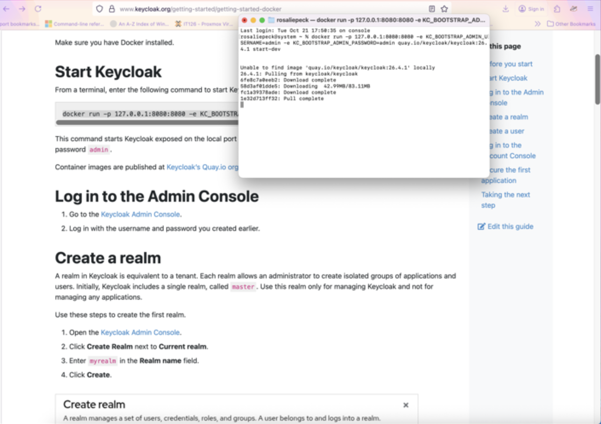
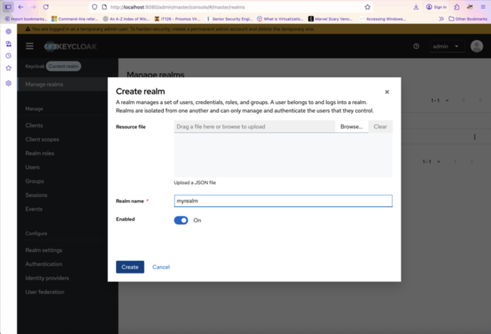
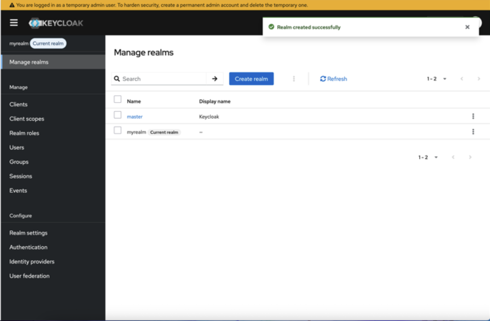
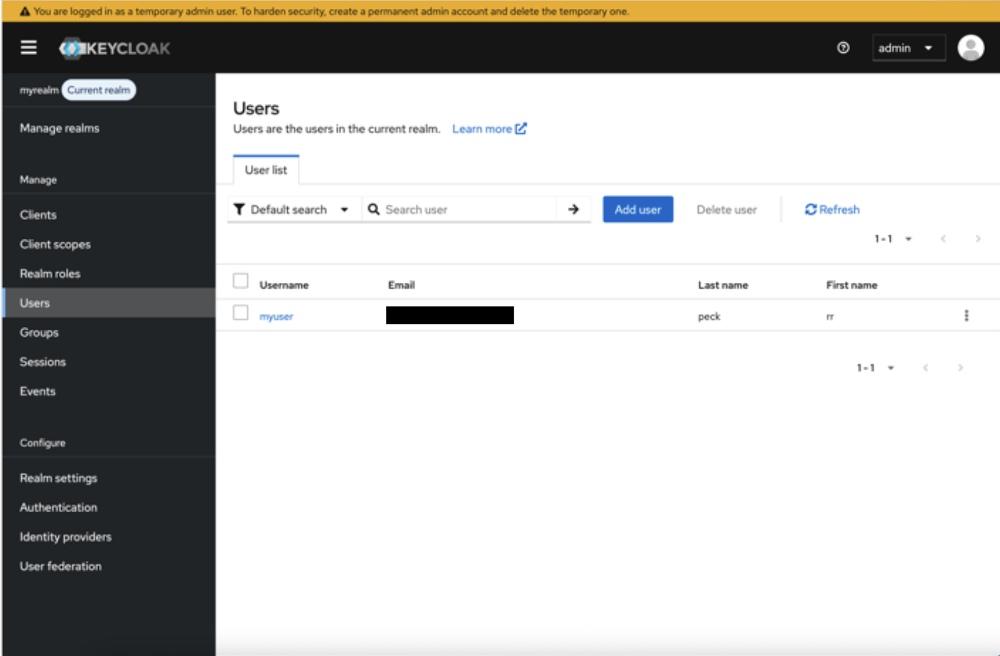
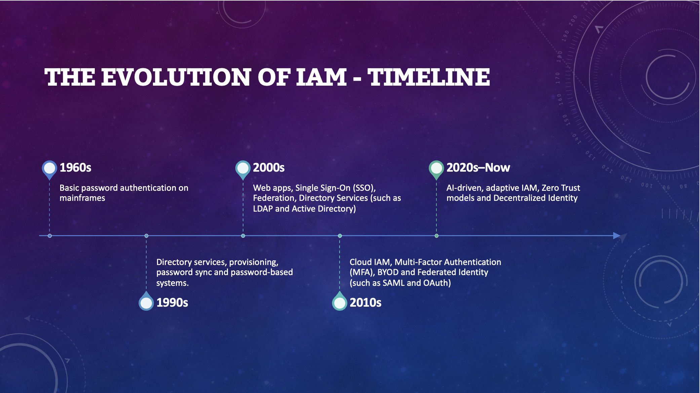

# Identity & Access Management Security Lab

## Project Overview

This project focused on Identity and Access Management (IAM) concepts and hands-on identity administration using Docker and Keycloak.

I deployed Keycloak locally in a Docker container, accessed the Keycloak Admin Console, created a custom realm, and provisioned a user within that realm. The project provided practical experience with identity isolation, user provisioning, authentication administration, and the role of IAM platforms in modern cybersecurity.

Related coursework also covered Microsoft Azure identity concepts, user and group management, Multi-Factor Authentication (MFA), and OpenID Connect.

## Objectives

- Deploy Keycloak using Docker.
- Access and manage the Keycloak Admin Console.
- Create an isolated realm for identity administration.
- Provision users within the custom realm.
- Understand the relationship between users, credentials, roles, groups, and realms.
- Review the evolution of IAM technologies.
- Connect modern IAM practices to concepts such as MFA, federation, Zero Trust, and adaptive authentication.

## Tools & Technologies

- Docker Desktop
- Keycloak
- macOS Terminal
- Web browser
- Microsoft Azure IAM coursework
- OpenID Connect
- Multi-Factor Authentication
- Single Sign-On
- Federation
- LDAP / Active Directory concepts
- SAML
- OAuth
- Zero Trust

## Keycloak Deployment with Docker

Keycloak was deployed locally using Docker.

The container was configured to expose Keycloak on local port `8080`, allowing the administration interface to be accessed through a browser.

*Keycloak container startup using Docker and local port 8080.*

Running Keycloak in a container provided an isolated environment for experimenting with IAM administration without requiring a full standalone server installation.

## Creating a Keycloak Realm

After accessing the Keycloak Admin Console, I created a custom realm named `myrealm`.

A realm provides an isolated environment for managing users, credentials, roles, groups, clients, and authentication settings.

*Creating a custom Keycloak realm for isolated identity management.*

## Realm Validation

After creating the new realm, Keycloak confirmed that the operation completed successfully.

The custom realm appeared alongside the default `master` realm and became the active environment for the next stages of identity configuration.

*Successful creation and activation of the custom Keycloak realm.*

The lab also highlighted an important administrative security practice: temporary bootstrap administrator accounts should be replaced with permanent administrative accounts when deploying Keycloak beyond a temporary lab environment.

## User Provisioning

A user account was created inside the custom realm.

This demonstrated the identity-provisioning portion of IAM administration, where accounts are created and managed within a defined security boundary.

*Provisioned user displayed within the custom Keycloak realm.*

In a production environment, additional controls could include:

- Password policies
- Multi-Factor Authentication
- Role assignments
- Group membership
- Session management
- Identity federation
- Authentication flows
- Least-privilege access

## IAM Evolution

Identity and Access Management has changed significantly as enterprise infrastructure has moved from centralized systems to web applications, cloud services, mobile devices, and distributed environments.

*IAM evolution from basic password authentication to modern adaptive IAM and Zero Trust.*

The progression included:

- **1960s:** Basic password authentication on mainframes
- **1990s:** Directory services, provisioning, and password synchronization
- **2000s:** Single Sign-On, federation, LDAP, and Active Directory
- **2010s:** Cloud IAM, MFA, BYOD, SAML, and OAuth
- **2020s–Now:** Adaptive IAM, Zero Trust, AI-driven identity security, and decentralized identity

## Related Azure IAM Coursework

Additional IAM coursework introduced Microsoft Azure identity-management concepts.

Topics included:

- Azure security and shared responsibility
- User and group management
- Azure Active Directory / Microsoft Entra identity concepts
- Multi-Factor Authentication
- OpenID Connect
- Application authentication

These concepts complement the Keycloak lab by showing how similar identity-management principles are implemented within cloud platforms.

## Security Lessons

This project reinforced several important IAM security principles:

- Identity should be treated as a major security boundary.
- Administrative accounts require stronger protection than normal user accounts.
- Users should be organized within clearly defined identity environments.
- Authentication and authorization serve different purposes.
- Multi-Factor Authentication reduces reliance on passwords alone.
- Identity federation can allow users to access multiple systems without maintaining separate credentials for every application.
- Least privilege should be applied when assigning roles and permissions.
- Modern Zero Trust models rely heavily on continuously validating identity and access.

## Troubleshooting Experience

The original plan involved running Docker and Keycloak inside a Windows 11 virtual machine.

After troubleshooting issues with the Windows VM, I changed approaches and installed Docker Desktop directly on macOS instead.

This allowed the Keycloak container to run successfully and the IAM lab to be completed.

The experience reinforced the importance of adapting deployment methods when the original implementation path creates unnecessary technical barriers.

## Skills Demonstrated

- Identity and Access Management
- Docker container deployment
- Keycloak administration
- Realm configuration
- User provisioning
- Authentication concepts
- Authorization concepts
- IAM security architecture
- Multi-Factor Authentication concepts
- OpenID Connect concepts
- Federation concepts
- Zero Trust concepts
- Technical troubleshooting
- Security documentation

## Lab Disclaimer

This project was completed in an authorized educational environment.

All accounts, realms, users, credentials, and configuration shown in this project were created specifically for lab and training purposes.

Any temporary credentials or personal information visible in the original coursework were removed or redacted before publication.